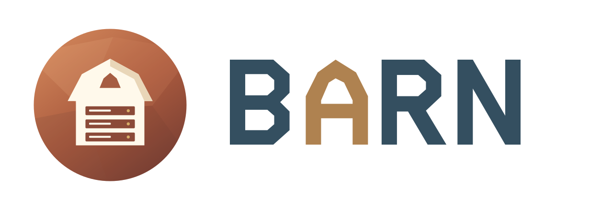

<h1 align="center">
  <a href="https://barn.pgsty.com/">
    <picture>
      <source media="(prefers-color-scheme: dark)" srcset="static/images/barn-logo-dark.svg">
      
    </picture>
  </a>
</h1>

<p align="center"><strong>Barn documentation and blog</strong></p>

<p align="center">
  <a href="https://barn.pgsty.com/">Website</a> ·
  <a href="https://barn.pgsty.com/docs/">Documentation</a> ·
  <a href="https://barn.pgsty.com/blog/">Blog</a> ·
  <a href="https://github.com/pgsty/barn">Source Code</a> ·
  <a href="https://barn.pgsty.com/zh/">中文</a>
</p>

This directory contains the bilingual documentation site for Barn: English at
`/` and Simplified Chinese at `/zh/`. The site uses Hugo Extended and Oink 1.3.2.

Paper is the default visual style. The Appearance menu lets readers switch
between Paper, Slate, Ink, and Terminal independently of light/dark mode.

The documentation covers **Barn 0.9.1**, released on 2026-10-22 through the
GitHub pre-release channel used by Barn 0.x. Current guides and download
examples target 0.9.1. Historical notes retain their original versions and
validation results.

The 0.9.1 downloads include the CLI and hosts helper; `Barn.app` remains a
source preview. Build it from tag `v0.9.1` with Go 1.27.3 and Xcode 27.
See the bilingual [0.9.1 notes](content/blog/release/0.9.1.md) and the source
repository's `docs/release-0.9.1.md` checklist.

## Brand assets

Barn uses **03 / Compute Barn** from `BARN-visual-concepts-v1.zip`: the
iron-oxide circular barn with three server bays, paired with the path-drawn
BARN wordmark and its copper A. Use this direction consistently.

| Asset | File | Use |
| --- | --- | --- |
| Graphic mark | [barn-mark.svg](static/images/barn-mark.svg) | Navbar, sidebar, favicon and application icons |
| Wordmark | [light](static/images/barn-wordmark.svg) · [dark](static/images/barn-wordmark-dark.svg) | Text-only SVG, transparent background |
| Combined logo | [light](static/images/barn-logo.svg) · [dark](static/images/barn-logo-dark.svg) | README and other horizontal placements |
| Dusk hero | [SVG](static/images/barn-hero.svg) · [PNG](static/images/barn-hero.png) | Homepage, default blog cover and social preview |

The palette is iron oxide `#A9573B`, slate `#344F60`, copper `#AF8250` and
warm ivory `#FFF9EB`. Both logo variants have transparent backgrounds. The
dark variant uses ivory lettering. The wordmarks contain paths, so no font
installation is required. The site theme toggle selects the matching wordmark.

The source repository's `.github/barn-logo.svg` and `barn-logo-dark.svg` are
copies of these combined logos. Its native `Barn.icns` and this site's
favicon/touch icons derive from the same selected mark; the original package
supplies simplified silhouettes for 16px and 32px sizes.

English and Chinese blog roots cascade `images/barn-hero.png` as the default
cover. A post can supply its own `images` front matter or a featured image in
its page bundle. Site-wide `params.images` supplies the social-preview default.

## Local development

The published dependency is pinned in `go.mod`. While Oink is developed from a
sibling checkout, use the local replacement target:

```bash
make dev
make check-local
```

To use the published theme dependency, run:

```bash
make build
make check
```

These targets clear `HUGO_MODULE_REPLACEMENTS` and disable Go/Hugo workspaces
so a shell's local Oink override cannot silently replace the pinned dependency.
The link checker requires a built homepage and fails on missing output.

For a content audit, compare the CLI, defaults, and examples with the matching
source tag and its tests. Use an isolated `BARN_HOME` for `validate` and `plan`.
Do not run lifecycle examples against an existing lab. Check translated page
pairs, code examples, and GitHub source/download links as well as the generated
HTML. Internal link checks cannot detect a missing file in a remote repository.

The production target is `https://barn.pgsty.com/`. Review build warnings;
the OINK 1.3.2 LibSass deprecation warning is accepted for this baseline. Do
not enable `--panicOnWarning` or `HUGO_PANICONWARNING`. Pages settings and DNS
must authorize that domain before publication.

The source-controlled `wrangler.toml` defines the Pages project, output
directory, `HUGO_VERSION=0.168.0`, and `GO_VERSION=1.27.3` for both Production
and Preview. Keep Go aligned with `go.mod` so Pages installs it before Hugo
resolves modules. Cloudflare's default Hugo can be older than Oink requires;
`HUGO_SERVER` is not a recognized version selector.

## Content policy

Store each English page beside its Chinese translation as `page.md` and
`page.zh.md`. Keep both versions consistent with the documented application version.
Use [the writing guide](STYLE_GUIDE.md) for sentence structure and project terminology.
It adapts ASD-STE100 principles to software documentation in both languages.
Blog posts live under `content/blog/article`, `content/blog/design`, or
`content/blog/release`; do not put regular posts directly under `content/blog`.

Preserve release notes, design rationale, and dated validation records when
renaming the product or updating the current guides. Update product naming
without dropping historical content. Keep original dates, versions, and test
results, and link superseded material from the history sections.

Lead with the reader’s task: choose a guest type, install, start, connect, and
manage it. Keep detailed options in the reference and design rationale in the
project pages and blog. Put dated validation records in the history section.
Verify behavior against the matching CLI and preserve the distinction between
application packages, the native macOS component, and image-catalog trust.
