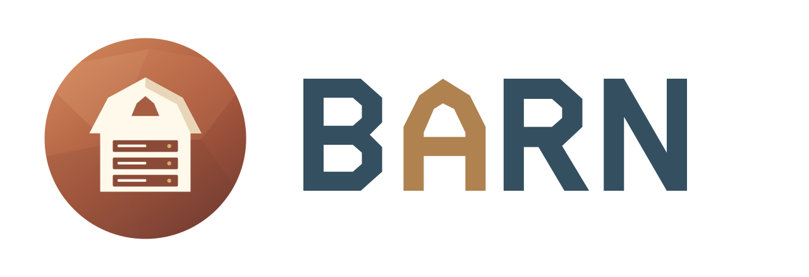

<h1 align="center">
  <a href="https://barn.pgsty.com/">
    <picture>
      <source media="(prefers-color-scheme: dark)" srcset="static/images/barn-logo-dark.svg">
      
    </picture>
  </a>
</h1>

<p align="center"><strong>Barn documentation and blog</strong></p>

<p align="center">
  <a href="https://barn.pgsty.com/">Website</a> ·
  <a href="https://barn.pgsty.com/docs/">Documentation</a> ·
  <a href="https://barn.pgsty.com/blog/">Blog</a> ·
  <a href="https://github.com/pgsty/barn">Source Code</a> ·
  <a href="https://barn.pgsty.com/zh/">中文</a>
</p>

This repository contains the bilingual documentation and blog site for Barn, published in English at `/` and Simplified Chinese at `/zh/`. The site builds with the latest Hugo Extended release and the [OINK `v1.5.1`](https://oink.pgsty.com/) theme.

Paper is the default visual preset. Readers can switch between Paper, Slate, Ink, and Terminal independently of light or dark mode from the Appearance menu.

Current guides and command references cover **Barn 1.2.0**, released on 2026-11-12. It adds lifecycle concurrency controls, unified VM resource overrides, recoverable root-disk growth, and inventory host names. New Linux VMs default to 1 vCPU and 2 GiB RAM. The Apple Silicon archive and Homebrew formula include the signed, notarized `Barn.app` alongside the CLI and helper; installation and use require no Go or Xcode. See the [1.2.0 release notes](content/blog/release/1.2.0.md), [command reference](content/docs/reference/commands/_index.md), and the historical [1.1.0 local acceptance](content/docs/about/local-acceptance-1.1.0.md).

Earlier release notes and validation records in [content/blog/release/](content/blog/release/) and [content/docs/about/history.md](content/docs/about/history.md) retain their original version numbers and test evidence.

## Brand assets

Barn uses **03 / Compute Barn** from `BARN-visual-concepts-v1.zip`: the iron-oxide circular barn with three server bays, paired with the path-drawn BARN wordmark and its copper `A`.

| Asset | File | Use |
| --- | --- | --- |
| Graphic mark | [barn-mark.svg](static/images/barn-mark.svg) | Navbar, sidebar, favicon, and application icons |
| Wordmark | [light](static/images/barn-wordmark.svg) · [dark](static/images/barn-wordmark-dark.svg) | Path-drawn text SVG on a transparent background |
| Combined logo | [light](static/images/barn-logo.svg) · [dark](static/images/barn-logo-dark.svg) | README and horizontal placements |
| Dusk hero | [SVG](static/images/barn-hero.svg) · [PNG](static/images/barn-hero.png) | Homepage hero, default blog cover, and social preview |

The brand palette pairs iron oxide `#A9573B`, slate `#344F60`, copper `#AF8250`, and warm ivory `#FFF9EB`. Both logo variants use transparent backgrounds and vector paths (no font installation required), with ivory lettering on the dark variant selected automatically by the site theme toggle.

The source repository's `.github/barn-logo.svg` and `barn-logo-dark.svg` mirror these combined logos, and its native `Barn.icns` and this site's favicon/touch icons derive from the same mark (with simplified silhouettes at `16px` and `32px`). English and Chinese blog sections cascade `images/barn-hero.png` as the default cover unless a post defines its own `images` front matter or page-bundle featured image.

## Local development

`go.mod` pins the published OINK module. To preview or validate against a sibling `../oink` checkout during theme development, run:

```bash
make dev
make check-local
```

To build and verify against the pinned `go.mod` dependency:

```bash
make build
make check
```

`make build` and `make check` clear `HUGO_MODULE_REPLACEMENTS` and disable Go/Hugo workspaces (`GOWORK=off`, `HUGO_MODULE_WORKSPACE=off`), then run the current Hugo Extended release in production mode followed by `bin/check_internal_links.py public`. Keep build warnings visible and do not enable `--panicOnWarning` or `HUGO_PANICONWARNING`; the upstream LibSass deprecation notice is expected on current Hugo Extended releases.

When auditing CLI behavior or configuration examples against the `v1.2.0` source tag or the source commit named by a release note, point `BARN_HOME` at a temporary directory for `validate` and `plan` so you do not touch an active local lab.

`wrangler.toml` configures Cloudflare Pages with the current supported Hugo release and `GO_VERSION=1.27.3` for both Production and Preview deployments, targeting `https://barn.pgsty.com/`.

The `content/render.html` and `print/page-content.html` partial overrides preserve OINK v1.5.1's rendering behavior and use `content/literal-code.html` to wrap code in Cloudflare's [email-obfuscation exclusion comments](https://developers.cloudflare.com/waf/tools/scrape-shield/email-address-obfuscation/#prevent-cloudflare-from-obfuscating-email). Without these guards, the CDN mistakes image selectors such as `u24@20261017.0.1` for email addresses. Keep `minify.tdewolff.html.keepComments` enabled, review the overrides when upgrading OINK, and verify literal examples on the public site after deployment; local HTML alone cannot exercise this CDN behavior.

## Content policy

Store each English page beside its Simplified Chinese counterpart as `page.md` and `page.zh.md`. Follow [STYLE_GUIDE.md](STYLE_GUIDE.md) for writing style, terminology, and OINK component usage. Place blog posts under `content/blog/article`, `content/blog/design`, or `content/blog/release`.

Lead with the user's task in `docs/start/`, keep exhaustive flag and schema tables in `docs/reference/`, explain architectural trade-offs in `docs/about/` and `blog/design/`, and preserve dated test evidence and release history in `docs/about/history` and `blog/release/`.
