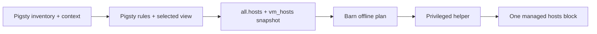

> [!NOTE]
> **Scope narrowed on 2026-11-11:** the first delivery is now [fixed core names and Pigsty CA trust](/blog/design/pigsty-host-setup/). This page retains the broader exporter and resolver research; its general inventory and split-DNS work is optional expansion, not a prerequisite for the fixed profile.

**Recommend explicit, opt-in managed hosts publication first.** Pigsty computes the names and service targets; Barn previews and installs one neutral address/name snapshot through its existing helper. This is worthwhile for opening portals, addressing nodes and connecting to database or VIP names in a static Linux lab. Fixed addresses make repeated synchronization cheap: unchanged records need no privileged operation. **Root is still required for every actual system hosts change, including removal.** Setup does not grant perpetual update permission, and a cached or passwordless sudo authorization eliminates a password prompt, not privilege. Keep per-command authorization; consider suffix forwarding when a stable guest DNS endpoint and a complete namespace exist. A host daemon needs demonstrated demand beyond these two options.

**Status:** design dated **2026-11-10**; evidence gathering and synthesis crossed into **2026-11-11, Asia/Shanghai**. The checked Barn `v1.1.0` source at [b2cc8da](https://github.com/pgsty/barn/tree/b2cc8da8983e710255d504bf26bf5d7b3f182790) has applied-node hosts publication. `vm_hosts`, `hosts install -f`, case normalization, and Pigsty `bin/sandbox-dns` are **dirty, unpublished prototypes** audited on those dates. Source selection guards, exporter modes, stronger transactions and DNS adapters below are **proposals**. Release binaries and real-platform behavior were not validated. The [migration article](/blog/design/pigsty-barn-migration/) provides broader context; this design specifies the DNS work independently.

## Choose the smallest useful publication mechanism {#decision}

| Alternative | Coverage and daily operation | Privilege and failure behavior | Decision |
|---|---|---|---|
| Managed hosts | Finite short names and FQDNs; explicit complete synchronization; resolution survives guest shutdown, although connections fail | Every changed write/removal is privileged; identical snapshot is a no-op; no resident service | **Recommended first implementation**, always opt-in |
| Suffix forwarding to guest DNS | Records actually served within an agreed zone; guest-side changes propagate without rewriting the host route | Privileged route installation, endpoint changes and removal; stable routes need no host privilege for record updates; guest DNS becomes a dependency | Optional next step, with separate macOS/Linux adapters and short-name handling |
| Host-local DNS daemon | Can support frequent record changes, wildcard or additional RR types; user-owned data can update independently of fixed system routing | Privileged service/routing setup and changes; daemon identity, ports, startup, crashes and upgrades become maintenance obligations | Defer until measured demand justifies it |
| Zero automatic configuration / manual | IPs, existing DNS or explicitly reviewed application/system overrides | Barn makes no system changes; user owns integration and cleanup | Always available; normal setup and VM lifecycle default to this policy |
{.wide .expand}

With no automation, Barn's SSH aliases and direct IP access remain usable. Multi-portal Host/TLS names, browser URLs and application settings still need existing DNS or manual overrides. Per-application overrides do not provide system-wide resolution, and manually copied mappings drift as the inventory changes.

The boundary remains one Linux deployment per user, one inventory format and one host-wide Barn block. A different `BARN_HOME` does not create another hosts namespace. Pigsty owns portal, PostgreSQL, VIP and MinIO meaning; Barn neither discovers Patroni leaders nor learns Pigsty roles. This preserves the [Barn contribution contract](https://github.com/pgsty/barn/blob/b2cc8da8983e710255d504bf26bf5d7b3f182790/CONTRIBUTING.md).



## Define names and views before choosing a resolver {#names-and-views}

The default proposed export is **host-access intent**, a useful union of selected portal ingress names, node identities, explicit records and service aliases. It can intentionally contain names absent from guest dnsmasq. Keep separate categories—`vm-identity`, `guest-hosts`, `infra-dns`, `portal-access`, `service-access`—and retain their source, view and target type in the export report. A `guest-dns` view instead reproduces the selected infra DNS output and its task conditions. Shared computation must unify identity and target rules while allowing these different output policies.

This table is the authoritative mapping policy. The source column describes audited Pigsty behavior; the final column is the proposed host-access policy.

| Name source | Audited meaning and destination | Host-access publication policy |
|---|---|---|
| Barn node identity and `vm_alias` | `nodename`, otherwise `pg_cluster-pg_seq`, otherwise `node-lastOctet`; aliases resolve to the node address | Include resolved VM names/aliases. Use `vm_hosts` for new service names so service edits do not change VM specifications. [Barn inventory](https://github.com/pgsty/barn/blob/b2cc8da8983e710255d504bf26bf5d7b3f182790/internal/config/inventory.go) |
| `node_default_etc_hosts`, `node_etc_hosts` | Guest hosts entries, gated by `node_write_etc_hosts`; substitute that node's effective `${admin_ip}` | Include the selected view's enabled entries as `guest-hosts`; parse each physical line separately. Node-name exchange is a separate task context. [Node DNS tasks](https://github.com/pgsty/pigsty/blob/1ee6597dd806605b600e90cf01948277748b45f3/roles/node/tasks/dns.yml) |
| `dns_records` | Infra hosts files with `${admin_ip}` substituted; `dns_enabled` gates service startup, not all file generation or removal of a running service | Include declared records with desired-config provenance; never infer DNS liveness from this switch. Guest dnsmasq uses `no-hosts`, so guest `/etc/hosts` is not automatically served. [Infra tasks](https://github.com/pgsty/pigsty/blob/1ee6597dd806605b600e90cf01948277748b45f3/roles/infra/tasks/dns.yml), [dnsmasq template](https://github.com/pgsty/pigsty/blob/1ee6597dd806605b600e90cf01948277748b45f3/roles/infra/templates/dns/dnsmasq.conf) |
| `infra_portal.*.domain/domains` | Nginx names, not automatic DNS records. Tasks require a nonempty `domain`; standard home/path/endpoint templates support aliases | Map enabled virtualhosts to an explicitly selected ingress, typically its effective `admin_ip`. Never use the backend `endpoint`, which may be loopback. Reject unsupported custom-template semantics; omit a `domains`-only skipped virtualhost with a diagnostic. [Portal task](https://github.com/pgsty/pigsty/blob/1ee6597dd806605b600e90cf01948277748b45f3/roles/infra/tasks/nginx.yml) |
| PG instance `pg_cluster-pg_seq` | Inventory address; PG DNS tasks are gated by the PG node's `dns_enabled`. Instance names receive no `pg_dns_suffix` | Include valid instance aliases as `service-access` even when guest DNS is disabled, explicitly labelled host convenience. This is not evidence of a deployed DNS record. [PG DNS tasks](https://github.com/pgsty/pigsty/blob/1ee6597dd806605b600e90cf01948277748b45f3/roles/pgsql/tasks/dns.yml) |
| PG cluster `pg_cluster + pg_dns_suffix` | Suffix concatenates directly, default empty. `auto`: enabled PG VIP, otherwise declared primary; `primary`: declared primary; `vip`: enabled VIP, otherwise no address; `none`: no address; explicit IP: configured target | Apply those target rules for `service-access`, labelling DNS-disabled convenience aliases. Require a unique declared primary where needed. Reject explicit CIDR targets: current role output retains the mask, while the prototype silently strips it. PG VIP branches deliberately strip the VIP mask. [PG defaults](https://github.com/pgsty/pigsty/blob/1ee6597dd806605b600e90cf01948277748b45f3/roles/pgsql/defaults/main.yml), [PG identity](https://github.com/pgsty/pigsty/blob/1ee6597dd806605b600e90cf01948277748b45f3/roles/pg_id/tasks/main.yml) |
| Node VIP `node_cluster + vip_dns_suffix` | Enabled `vip_address`, independent of PG VIP; effective node identity rules matter | Include validated bare VIP addresses. Reject CIDR here pending a shared role/export correction, because the current DNS task writes the value unchanged. [Node monitor tasks](https://github.com/pgsty/pigsty/blob/1ee6597dd806605b600e90cf01948277748b45f3/roles/node_monitor/tasks/main.yml) |
| MinIO member names | Expanded `minio_node` plus `minio_cluster-minio_seq` map to member IPs | Include member identities. Publish a MinIO service name only when declared through `dns_records`, enabled node hosts, portal policy or explicit `vm_hosts`; `minio_domain` alone supplies certificate/client naming, not a DNS record. [MinIO identity](https://github.com/pgsty/pigsty/blob/1ee6597dd806605b600e90cf01948277748b45f3/roles/minio/tasks/main.yml), [MinIO configuration](https://github.com/pgsty/pigsty/blob/1ee6597dd806605b600e90cf01948277748b45f3/roles/minio/tasks/config.yml) |
| Explicit `all.vars.vm_hosts` | Prototype-only neutral `{address, names}` entries | Include as explicit intent, with the same conflict checks; explicit entries do not silently override contradictory derived records |
{.wide .expand}

Barn VM names are short lowercase labels, at most 63 characters. Pigsty can rename the guest differently: `node_id_from_pg: true` can override an explicit `nodename`, while Barn's fallback does not consult that switch. For matching identities, choose an explicit short `nodename` and disable Pigsty's PG-derived override where appropriate; put FQDNs in aliases. See [Pigsty node identity](https://github.com/pgsty/pigsty/blob/1ee6597dd806605b600e90cf01948277748b45f3/roles/node_id/tasks/main.yml).

Multiple infra nodes can legitimately have different `admin_ip` and `i.pigsty` views. The host needs one explicit ingress/view, distinct names, or a stable shared entry point. Never choose the first infra node. DNS replicas qualify as redundant upstreams only after their relevant answers and published generation agree.

## Export one existing inventory shape, with honest limits {#export-contract}

The viable prototype boundary is this minimal projection of the existing inventory format. The `.100` target below is illustrative and requires a separately configured, reachable VIP.

```yaml {title="host-names.yml — prototype-compatible shape"}
all:
  hosts:
    10.10.10.10: {nodename: meta}
  vars:
    vm_hosts:
      - address: 10.10.10.10
        names: [i.pigsty, meta]
      - address: 10.10.10.100
        names: [pg-meta]
```

`vm_hosts` is allowed only under `all.vars`; entries accept exactly `address` and a nonempty string list `names`. Provenance stays in a separate report, never extra entry keys. **At least one managed host is required:** a `vm_hosts`-only document currently fails with `inventory defines no hosts`. `all.hosts` supplies node identity and `/24` context. This generated projection is disposable output, not another user-maintained inventory. It can be published before VM creation; it does not prove that nodes or services exist.

The current Barn adapter accepts one canonical RFC1918 IPv4 address per name, inside the managed `/24`, with usable suffixes `.9`–`.254`. `.1` belongs to the host; `.2`–`.8` are reserved; `.0` and `.255` are unusable. Multiple A answers, external destinations, IPv6, wildcards and non-address RR types require an explicit alternative; hosts or DNS capabilities in general do not widen this adapter. Custom private `/24`s work only after Pigsty's `admin_ip`, records and VIPs are adjusted consistently. DNS creates neither routes nor VIPs. [Barn network layout](https://github.com/pgsty/barn/blob/b2cc8da8983e710255d504bf26bf5d7b3f182790/internal/network/subnet/layout.go)

### Ship a limited literal mode before general Ansible support {#export-modes}

**Proposed modes:** `literal` produces desired host-access intent for declared static profiles; `rendered` computes a selected view using the normal Pigsty controller's effective variables and role rules; `observed` explicitly collects a chosen infra node's deployed DNS data and service observations. Rendered intent can differ from installed files after skipped/failed tasks; observed files can differ from active answers. Reports must state which evidence was collected and when. Neither mode means live Patroni authority.

Phase 1 literal support is deliberately narrow: one YAML source, known defaults kept in their role contexts, unambiguous inheritance, supported standard portal templates and the documented `${admin_ip}`/MinIO substitutions. Detect and reject adjacent/controller `group_vars` or `host_vars`, multiple sources/plugins, DNS-relevant Jinja/lookups/facts, ambiguous sibling overrides and unsupported task contexts. Never silently ignore a variable source. Parse escaped and block newlines as separate records; reject malformed types and CIDR cases rather than repairing them into different role semantics.

Compute identities and targets across all relevant Pigsty hosts, including `vm_skip` external primary/infra nodes, before applying Barn's address boundary. Until that calculation is supported, refuse affected profiles rather than omit their roles. Include all known external addresses in VIP collision checks. An unrelated skipped host is not permission to discard DNS-relevant configuration.

Phase 2 introduces shared Pigsty pure rules plus an effective-variable adapter, with role-render equivalence tests **within each selected view**. `ansible-inventory --list` handles inventory variables, not every role default, `set_fact`, task condition or controller template. General support needs explicit context for those inputs and refusal of unresolved values. Controlled read-only export can run on the normal Pigsty controller and transfer the sanitized projection to the host; host users need not install Ansible. Complete pre-VM export remains limited to profiles whose inputs are available without guest facts. [Ansible variable merging](https://docs.ansible.com/projects/ansible/latest/inventory_guide/intro_inventory.html#how-variables-are-merged)

Bind validation and extraction to one input generation, checking relevant source/default files for changes before publication. Emit only node identities and names into a mode-`0600` temporary file; never persist full hostvars, credentials or share settings. Proposed `--mode`, `--view` and `--export` options belong to Pigsty, not Barn. Default `--view host-access` requires an unambiguous ingress; `host-access:<infra-node>` explicitly selects its view, while `guest-dns:<infra-node>` selects DNS output. Phase 1 rejects unsupported selections. `observed` initially supports only `guest-dns`, without inventing convenience records. `--export FILE` writes only the projection and is mutually exclusive with applying it. Existing `--json` retains its Barn-plan meaning.

## Make source replacement explicit and preserve service names {#source-selection}

| Evidence | What it establishes | What it cannot establish |
|---|---|---|
| Current desired inventory/export | Names to publish, including before VM creation | Applied nodes, successful Pigsty tasks or runtime DNS |
| Barn applied node state | Committed node addresses, names and `vm_alias`, including stopped nodes | `vm_hosts`, portals, service aliases or current leader |
| Installed block and metadata | Current host file contents and the recorded source kind | A current source pathname, live guests or fresh deployed DNS |
{.wide}

The prototype replaces the entire block. Consequently, running bare `hosts install` after `hosts install -f` can remove inventory-only service aliases. **Proposed minimal guard:** store one stable ordinary comment, `# source-kind: inventory` or `# source-kind: applied`, inside the existing block. Do not invent a `# barn:` marker: the current parser rejects unknown markers. This metadata is a CLI source safeguard, independent of OS authorization.

| Installed block | Bare `hosts install` under the proposal | Explicit source selection |
|---|---|---|
| Absent, legacy unmarked, or `applied` | Preserve tagged behavior: derive applied-node snapshot, preview/confirm as usual | `-f FILE` selects inventory; `--from-applied` selects applied state |
| `inventory` | Fail before sudo, including with `--yes`; explain how to retain or replace services | `-f FILE` replaces with a complete inventory snapshot; proposed `--from-applied` explicitly authorizes node-only replacement, showing removals |
| Unknown/duplicate source metadata or malformed block | Fail with repair guidance | No automatic overwrite |
{.wide}

`-f` and proposed `--from-applied` are mutually exclusive. A different `-f` is itself an explicit source switch. Remember no source pathname, particularly no Pigsty temporary path; introduce no publisher registry or project scopes. Omitted records disappear on the next complete synchronization. `vm_hosts: []` leaves that source's node names/aliases. Failed extraction or an invalid empty inventory must never clear the block; complete removal uses `hosts uninstall`. Removing a name never destroys a VM.

Fingerprint published canonical records and source kind for semantic no-op detection. Keep input hashes, rules version, selected view and detailed provenance in the unprivileged report, not timestamped block comments. Password, CPU, file-path or irrelevant inventory edits must not force root writes. Still compare actual target bytes: a matching record digest cannot hide a damaged marker or external edit. Adding the source comment to an old block is a one-time privileged migration.

An unmarked prototype block cannot reliably reveal whether it contained inventory services. Upgrade by explicitly reinstalling the complete `-f` snapshot before using bare install. Require a CLI implementing this guard and its matching helper; the minimum release number remains to be assigned. Old CLIs can overwrite the block despite its comment, so a downgrade is not safe. The wrapper must check required capabilities, not merely a version string.

## Preview offline, then authorize the actual change {#operator-workflow}

The audited prototype already has the following interfaces; their existence does not satisfy the implementation gates below.

| Existing interface | Exact behavior |
|---|---|
| `bin/sandbox-dns -f FILE --json` | Barn plan JSON, not a record export; default file is `pigsty.yml` |
| `bin/sandbox-dns -f FILE --apply` | Wrapper previews, then invokes Barn with `--yes` |
| `barn hosts install -f FILE --json` | Inventory preview, no application |
| `barn hosts install -f FILE --yes` | Apply inventory snapshot; Barn has no `--apply` flag |
| `barn hosts install -f FILE --json --yes` | Apply and return structured output; JSON does not imply read-only |
| `barn hosts uninstall --json` / `--yes` | Preview / explicitly remove the whole Barn block |
{.wide}

**Proposed operator workflow after Phase 1 acceptance:** preview and explicitly apply from Pigsty, repeating the same process after portal, node or VIP changes. These two command spellings exist in the prototype; the safer semantics are proposed.

```bash {title="Proposed routine workflow"}
bin/sandbox-dns -f pigsty.yml --json
bin/sandbox-dns -f pigsty.yml --apply
```

For review or controller-to-host transfer, the proposed exporter produces the same disposable projection. Only `--mode`, `--view` and `--export` below are new options.

```bash {title="Proposed explicit export workflow"}
bin/sandbox-dns -f pigsty.yml --mode literal --view host-access --export host-names.yml
barn hosts install -f host-names.yml --json
barn hosts install -f host-names.yml --yes
```

Returning to node-only publication intentionally removes service aliases. The proposed `--from-applied` makes that replacement explicit; uninstall already exists and needs neither inventory nor deployment state.

```bash {title="Proposed source switch, followed by independent cleanup examples"}
barn hosts install --from-applied --json
barn hosts install --from-applied --yes
barn hosts uninstall --json
barn hosts uninstall --yes
```

Every applying invocation must build and display its own complete plan **before requesting root**: added, changed, removed and retained names; old/new addresses; category, source kind and provenance; conflicts; native target; record generation and byte preconditions. Proposed diffs must account for names removed from the previous block even when their old field-level provenance is unavailable. Plans use local files/state only—no DNS lookup, guest connection, downloads or helper installation. An observed export is collected separately before planning. Do not print secrets or full hostvars.

| Proposed outcome contract | Result |
|---|---|
| Preview (`--json` without `--yes`, or no terminal without `--yes`) | Exit 0 on a valid plan, `applied: false`; no sudo, even if changes exist |
| Unchanged semantic records and valid installed bytes | Exit 0, `changed: false`, no helper installation or sudo |
| Interactive text without `--yes` | Show plan and ask; Barn install defaults Yes and uninstall No; wrapper remains preview-only without `--apply` |
| Explicit apply without a terminal | Use nonblocking authorization; lack of permission is a capability error, nonzero exit, no password wait and no hosts write |
| Invalid input, source switch violation, conflict or stale generation | Nonzero error before write; require a fresh plan, never silently regenerate and commit different data |
| Verified write / post-write failure | Exit 0 only after verification; otherwise report failure and any partial state, without claiming a successful rollback |
{.wide}

Keep Barn's `{plan, applied}` report shape. Its current plan has `schema`, `action`, `target`, `changed`, before/after hashes and optional `lines`/helper digest; source/diff details are additions. The current Python wrapper does not guarantee JSON errors; structured failure parity is a Phase 1 task.

### Strengthen the existing privileged boundary {#privilege-boundary}

Current CLI planning limits normal edits to its block. The fixed helper validates the native target, caller/staging ownership, permissions and hashes, uses atomic replacement and verifies resulting bytes plus uid/gid/mode. **It does not independently prove that the staged file changes only the Barn block, and no transaction lock spans check and rename.** Passing tests do not cover those gaps. A caller-supplied digest proves byte identity, not allowed scope; atomic rename does not provide compare-and-swap. [Tagged helper implementation](https://github.com/pgsty/barn/blob/b2cc8da8983e710255d504bf26bf5d7b3f182790/internal/hostconfig/hostconfig.go#L595)

Proposed application keeps the same boundary: the helper acquires a root-owned host-wide cooperative lock, rereads the target, checks the reviewed digest, validates bounded records/source metadata and conflicts, reconstructs the permitted replacement itself, then compares, writes atomically and verifies. Uninstall may only remove that block. Preserve outside bytes, with the documented first-append newline exception; test additional filesystem metadata before promising its preservation. Retain stale-byte checks because unrelated root editors need not honor Barn's lock. Freeze the generated source through application; the wrapper must bind its displayed plan to the apply request, or let one Barn invocation display and apply the authoritative plan, rather than discard a preview between subprocesses.

Per-command sudo remains primary. Setup installs a root-owned, digest-matched helper; actual writes still execute with privilege. `--yes` bypasses Barn confirmation only. Current noninteractive authorization uses `sudo -n`, while an interactive invocation can ask for authentication. Persistent narrow sudo authorization is optional future work **after** helper-side scope validation and locking; never authorize arbitrary configuration includes or expand to unrestricted sudo. A helper-only rule also needs a scoped capability probe: today's `sudo -v`/`true` probes can reject such a rule. [Sudo behavior](https://raw.githubusercontent.com/sudo-project/sudo/main/docs/sudo.man.in), [sudoers command arguments](https://raw.githubusercontent.com/sudo-project/sudo/main/docs/sudoers.man.in)

## Own cleanup separately from VM lifecycle {#lifecycle-and-migration}

| Event | Proposed ownership and residual state |
|---|---|
| First setup / boot / `up` | Prepare networking/helper as appropriate; offer the explicit DNS workflow. Publish only on opt-in; inventory intent may precede VMs. No implicit hosts synchronization |
| Repeat sync / guest provisioning | Pigsty regenerates the complete selected view; Barn compares and publishes. Provisioning does not silently elevate the host |
| `stop`, start or restart | Keep names. Report that a resolved address may be offline; no root request just for lifecycle |
| Node removal, `destroy` or deployment purge | Keep the installed block; display lingering names and the explicit cleanup command. With a desired source, report its diff; with only applied state, diagnose absent nodes without guessing service intent |
| `hosts uninstall` | Remove only the Barn block; preserve current outside content, VMs, disks and guest DNS |
| Delete `BARN_HOME` / reinstall tool | Cleanup remains possible from the native block. Reinstall a compatible CLI/helper and run `hosts uninstall`; neither deleted state nor remembered source is required |
| Uninstall Barn software | Explain that removing binaries leaves host records. Offer cleanup first as a separate explicit operation; retain a documented compatible-reinstall or administrator block-edit recovery path |
{.wide}

Proposed diagnostics compare source kind, canonical record generation and current bytes, rather than merely noticing a begin marker. They distinguish stale desired exports, unavailable applied state and stopped guests. A fresh publication is not a service health check.

Old [Pigsty Vagrant DNS](https://github.com/pgsty/pigsty/blob/1ee6597dd806605b600e90cf01948277748b45f3/vagrant/dns) uses **per-line `# pigsty dns` comments**, not a paired block, and maps a fixed alias list to the first VM. Barn must preserve these foreign lines: same-address duplicates remain; different addresses conflict. Migration first inventories the marked lines, compares them against the complete new view and highlights old-only names. An explicit Pigsty migration step or administrator then removes only reviewed old records, with a fresh file comparison, before Barn publishes. Do not delete by `.pigsty` suffix or reuse the old script's broad substring deletion. Barn's narrow helper must not acquire Vagrant-line ownership. Verify duplicates are gone so later Barn uninstall really removes the intended names.

## Treat service reachability and HA as separate contracts {#ha-and-addresses}

`pg_primary_ip` is the inventory's unique declared primary, including relevant external hosts; it is not the current Patroni leader. The audited [failover callback](https://github.com/pgsty/pigsty/blob/1ee6597dd806605b600e90cf01948277748b45f3/files/postgres/pg-failover-callback) does not update DNS. Direct PostgreSQL connections to that address retain static-node semantics. HAProxy role ports at that same address can route to the current backend role, but the proxy node's address must itself remain reachable. A reachable VIP or redundant proxy entry point provides a stable publication target; [vip-manager](https://github.com/pgsty/pigsty/blob/1ee6597dd806605b600e90cf01948277748b45f3/roles/pgsql/templates/vip-manager.yml) can move the PG VIP according to the DCS leader. DNS server redundancy, correct service target and successful client reconnection need separate tests; existing TCP connections do not migrate when DNS changes.

Nine audited configuration paths have reserved PG VIP conflicts: `demo/debian`, `demo/el`, `fat`, `ha/dual`, `ha/full`, `ha/octo`, `ha/safe`, `ha/simu`, `ha/trio`. The current `pigsty.yml` separately has `.2` conflicts. `build/dev` and `build/oss` need explicit host-facing `i.pigsty` selection; `demo/demo` needs a short Barn name instead of its FQDN `nodename`. Correct all dependent records, URLs and connection settings together.

Candidate `.100/.101/.102` addresses had zero literal matches in raw and YAML-decoded scans of **54 configuration paths, current `pigsty.yml` and 7 role defaults: 62 paths total**. This only supports allocation within that audited corpus. It is not an IPAM reservation or a check of DHCP leases, ARP, external nodes, generated expressions or the live network. VIP collision and failover tests remain required on each target platform; relaxing Barn's reserved-address validator cannot solve a network conflict.

## Upgrade to split DNS only with a complete namespace {#split-dns}

Keep legacy `.pigsty` unchanged by default. For an optional new zone, prefer the narrowly scoped `pigsty.test`; `.test` is reserved for testing, whereas `.pigsty` has no special-use reservation. Avoid `.local`, which belongs to mDNS. Changing zones also requires coordinated records, portal URLs and certificates; a routing rule alone cannot rename an application. [IANA registry](https://www.iana.org/assignments/special-use-domain-names/special-use-domain-names.xhtml), [RFC 6761](https://www.rfc-editor.org/rfc/rfc6761.html#section-6.2), [RFC 6762](https://www.rfc-editor.org/rfc/rfc6762.html#section-3)

**Suffix forwarding does not solve current short names.** Neither `/etc/resolver/pigsty` nor Linux `~pigsty` automatically sends bare `meta`, `pg-meta` or `pg-meta-1` to Pigsty. The audited cluster suffix defaults empty; instance records have no suffix. Before enabling a route, publish corresponding node/instance FQDNs and, for clusters, an explicit `pg_dns_suffix`, such as `.pigsty.test`. Keep finite hosts aliases for short-name compatibility by default. Search-domain installation is a separate opt-in and works only when the completed FQDN actually exists. A local high-port daemon has exactly the same routing prerequisite. [systemd routing versus search](https://systemd.io/RESOLVED-VPNS/)

### macOS uses one owned resolver file {#macos-routing}

**Proposed configuration, not installed:**

```text {title="/private/etc/resolver/barn.pigsty.test"}
domain pigsty.test
nameserver 10.10.10.10
port 53
```

macOS supports domain-specific resolvers and explicit ports. The filename supplies the domain only when `domain` is absent; longest suffix matching applies. The proposal uses an explicit domain and no automatic search list. Refuse an existing same-zone route or owned-path collision, including VPN configuration. Create only the missing owned file/directory with appropriate root ownership; keep backups and staging content outside the resolver directory. Verify activation with `scutil --dns`, `dscacheutil` and system `getaddrinfo()`. Direct `dig @server` tests the DNS server, not macOS native routing. Reinitialization and cache convergence need target-version acceptance. [Apple resolver manual](https://raw.githubusercontent.com/apple-oss-distributions/libresolv/main/resolver.5), [Apple configd parser](https://github.com/apple-oss-distributions/configd/blob/585b7f2fca293f4642d21d15c5daf187f63c4796/dnsinfo/dnsinfo_flatfile.c#L366)

Installation, endpoint changes and removal require privilege; guest record updates with an unchanged route do not. Uninstall deletes only the still-matching Barn file and verifies route disappearance. Preserve VPN/default resolvers and later user edits; never restore a whole old DNS configuration.

### Linux must detect the resolver and its owner {#linux-routing}

Detection is read-only: inspect resolved's running state, NSS `hosts:` ordering, the `/etc/resolv.conf` target and the effective NetworkManager DNS plugin. A file listing upstreams directly can bypass resolved's per-link routing. An active NetworkManager alone proves no split-DNS capability. Probe supported versions/features rather than changing the host's DNS stack. [resolved client paths](https://raw.githubusercontent.com/systemd/systemd/main/man/systemd-resolved.service.xml), [NetworkManager plugins](https://networkmanager.dev/docs/api/latest/NetworkManager.conf.html)

| Supported adapter, proposed | Persistent installation and activation | Removal and limits |
|---|---|---|
| networkd + resolved, on an exclusively Barn-owned link | Owned drop-in for the verified Barn `.network`: `DNS=10.10.10.10`, `Domains=~pigsty.test`, `DNSDefaultRoute=no`; reload/reconfigure only that link | Remove matching own drop-in, reread effective state; preserve other files and settings |
| NetworkManager + resolved | Address the Barn profile by UUID; set its DNS and `ipv4.dns-search=~pigsty.test`, reapply and verify resolved | Restore only owned properties still matching applied values; never delete a shared profile or change global plugin |
| NetworkManager with existing dnsmasq plugin | Use the Barn profile's conditional forwarding; custom-port support requires separate detection | Same profile ownership rules; do not enable a new global plugin automatically |
| Runtime resolved | Only an active, exclusively Barn-owned non-loopback link; explicitly report lack of reboot persistence | Whole-link `revert` only when all affected configuration is demonstrably Barn-owned; never on shared/VPN/physical links |
| Unsupported resolver or ambiguous ownership | Explain the missing capability and retain hosts/manual mode | No global nameserver or `/etc/resolv.conf` takeover |
{.wide .expand}

Never generate `~.`. `DNSDefaultRoute=no` cannot cancel a catch-all domain. Preserve priorities and DHCP/VPN configuration; do not use negative NetworkManager priorities to win unrelated zones. Port 53 is the initial guest-forwarding baseline. Do not copy newer resolved custom-port syntax blindly into older NM profiles. The loopback interface is not a general resolved routing scope; a localhost daemon needs a supported routing mechanism. Last-guest shutdown can remove `barn0` carrier or the link itself, invalidating its DNS scope and allowing queries to follow default routes. Strict private-zone non-leakage therefore needs a stable route, server-side negative policy and real tests. [networkd DNS settings](https://raw.githubusercontent.com/systemd/systemd/main/man/systemd.network.xml), [NM priority/search](https://networkmanager.dev/docs/api/latest/settings-ipv4.html), [resolvectl reset scope](https://raw.githubusercontent.com/systemd/systemd/main/man/resolvectl.xml), [resolved link eligibility](https://github.com/systemd/systemd/blob/main/src/resolve/resolved-link.c)

Both platforms need a root-owned journal outside deployment state recording owned paths/profile UUID, prior existence, applied values and metadata. Prepare and verify upstream UDP/TCP service before enabling routes; compare the reviewed configuration again before writing; verify native resolution afterward. Roll back only still-owned deltas, reporting partial state on drift or interruption. A stored ifindex is not a durable identity. Switching from hosts requires removing overlapping Barn records explicitly and reporting foreign hosts overrides. NM profile persistence and runtime activation must both be checked. [nmcli persistence and reapply](https://networkmanager.dev/docs/api/latest/nmcli.html)

### A daemon must earn its lifecycle cost {#daemon-and-resolution-limits}

A future daemon should bind loopback only, preferably a supported high port; accept bounded records from the intended user; validate a complete generation before atomic activation; retain the last good generation on bad input. Fixed root-owned service/routing configuration must not execute user-writable programs or arbitrary includes as root. Installation, service upgrades and routing changes remain privileged. User agents end at logout; a system service adds installation and maintenance. Test startup order, restart backoff, port occupation and process identity. Remove routes and verify removal before stopping an intentionally uninstalled daemon. A crash should be diagnosable without silently forwarding private names publicly. [Apple high-port implementation](https://github.com/apple/container/blob/d5416e63231783c9699d31f35381caac941d3cde/Sources/Services/ContainerAPIService/Client/HostDNSResolver.swift#L38)

Hosts has no wildcard behavior. Future wildcard DNS should cover only a deliberate shared ingress subzone, not all Pigsty names. Define NXDOMAIN for unknown names and NODATA for absent record types; dnsmasq domain matching and local-zone policy require careful configuration. Support UDP and TCP. An AAAA answer and the transport used to query DNS are independent: do not invent unreachable IPv6 addresses or `::1`. Barn's present export remains IPv4-only; dual-stack records require a new adapter contract. [dnsmasq manual](https://thekelleys.org.uk/dnsmasq/docs/dnsmasq-man.html), [RFC 3596](https://www.rfc-editor.org/rfc/rfc3596.html), [RFC 7766](https://www.rfc-editor.org/rfc/rfc7766.html)

System, application and negative caches can retain older results. Browser/SDK DoH may bypass native routing. Existing hosts entries can mask DNS, subject to the actual NSS path; VPNs can change both route reachability and zone selection. Test these paths and report measured convergence instead of promising instant updates or flushing every cache on every sync. [DoH client policy](https://www.rfc-editor.org/rfc/rfc8484.html#section-3)

## Evidence establishes a prototype, not platform acceptance {#evidence}

| Recorded offline evidence | Result and interpretation |
|---|---|
| Barn hosts/config/helper/CLI tests | **16 top-level tests passed**; temporary-file writes and preview coverage, including malformed blocks, conflicts, reserved addresses, helper pairing and no-deployment inventory preview |
| Pigsty extractor tests | **11 passed**; application subprocesses mocked, sanitized projection and preview behavior covered |
| Adversarial fixtures | **21 observations reproduced**, including four Ansible inventory comparisons; these expose gaps, not 21 correctness passes |
| Configuration corpus | **54 paths**, including a symlink alias; **53 Barn-VM-valid, 42 extractor-accepted**. Parser acceptance does not certify role equivalence or deployment success |
| Actual prototype preview | `conf/meta.yml` produced 10 names and `applied: false`; native hosts bytes remained unchanged |
{.wide}

The adversarial evidence found ignored `group_vars`/`host_vars`, different sibling precedence, multiline/escaped-newline misaddressing, skipped virtualhosts exported, external-role omission and incomplete address collision checks. It also exposed mixed-view ambiguity, unrepresentable multiple addresses and incorrectly normalized explicit CIDR targets. PG aliases under `dns_enabled: false` require the explicit host-convenience policy above; their existence alone is not a defect. Silent wrong addresses and claims of deployed-DNS equivalence are defects.

Offline review retained fixtures, per-template results, commands and source fingerprints. No private configuration or native-hosts hashes are reproduced here. Barn DNS-related files matched those fingerprints during synthesis even though concurrent work moved local HEAD to `158786a1fee011edf3a1673400b8dd40ba9a7261`; Pigsty's checked baseline is `1ee6597dd806605b600e90cf01948277748b45f3`. Unpublished evidence lives in Barn `internal/hostconfig`, `internal/config`, `cmd/barn/hosts_inventory_test.go`, and Pigsty `bin/sandbox-dns` / `tests/test_sandbox_dns.py`; these are paths, not claims that public baseline links contain the prototypes.

To reproduce the targeted tests with the same candidate, first set `DNS_AUDIT_DIR` to the absolute path of an existing disposable directory outside the checkout; the commands use it for all caches and state. These are **reproduction instructions, not additional checks performed during this documentation synthesis**:

```bash {title="Barn checkout — offline reproduction"}
export GOTOOLCHAIN=local GOPROXY=off GOSUMDB=off GOENV=off GOWORK=off
export GOFLAGS=-mod=readonly
export GOCACHE="${DNS_AUDIT_DIR:?}/go-cache"
export GOTMPDIR="${DNS_AUDIT_DIR:?}/go-tmp" TMPDIR="${DNS_AUDIT_DIR:?}/tmp"
export BARN_HOME="${DNS_AUDIT_DIR:?}/barn-home"
mkdir -p "$GOCACHE" "$GOTMPDIR" "$TMPDIR" "$BARN_HOME"
go test -count=1 -v \
  -run '^(TestReconcile.*|TestApplyHelper.*|TestInstalledHelperValidation.*|TestCompanionHelperDigest.*|TestHelper.*|TestParseInventoryVMHosts.*|TestHostsInventoryPreviewNeedsNoDeployment)$' \
  ./internal/hostconfig ./internal/config ./cmd/barn-hosts-helper ./cmd/barn
```

```bash {title="Pigsty checkout — offline reproduction"}
python3 -B -m unittest discover -s tests -p test_sandbox_dns.py -v
```

The recorded environment used Go 1.27.3 on darwin/arm64, Python 3.14, PyYAML 6.0.3 and Ansible 2.21.5 for inventory comparisons. Reproduce corpus counts by enumerating sorted `conf/**/*.yml` paths including symlinks, running candidate `barn validate --json`, then the same extractor. Promote the saved adversarial fixtures into repository tests before release. No sudo, system configuration changes, VM operations or playbooks were executed in this research. Real resolver activation, VPN behavior, cache timing and HA remain pending; the main documentation workflow runs the site check separately.

## Implement in stages with explicit acceptance gates {#implementation-plan}

| Phase and owner | Work checklist | Acceptance gate |
|---|---|---|
| **0 — Pigsty semantics** | Separate output views; fix silent parser/override/virtualhost errors; handle or reject external roles; settle CIDR rules; correct reserved VIPs, multi-infra selection and VM identities | Every supported static profile has reviewed expected records and provenance; unsupported inputs fail visibly; 21 adversarial observations become expected-result regressions |
| **1 — Pigsty exporter + Barn hosts** | Limited literal export; exact existing projection; source-kind guard and explicit applied replacement; full offline diff; frozen input; structured failures; helper scope validation and cooperative lock | Inventory services survive attempted bare install; no-op needs no sudo; every actual write verifies; targeted tests and required repository checks pass |
| **2 — integration and HA** | Shared pure rules/effective-variable adapter; controller-side rendered/observed export; lifecycle diagnostics, migration and reinstall cleanup; real platform validation | Per-view role equivalence and supported-profile coverage; host access and VIP failover on macOS arm64 and Linux amd64, extending to other advertised hosts |
| **3 — optional split DNS** | FQDN publication, stable endpoint, capability detection, ownership journal and platform adapters | Suffix isolation, persistence, rollback and failure matrix pass; short names retain their stated contract |
| **Demand gate — local daemon** | Measure update frequency or RR requirements unsatisfied above; define service identity and lifecycle | Demonstrated benefit exceeds service maintenance; outage, logout, port and upgrade tests pass |
{.wide .expand}

| Required test area | Concrete acceptance cases |
|---|---|
| Semantics | Overrides, sibling groups, defaults/templates, multiline data, portal conditions, PG target branches, MinIO service-name origin, `vm_skip`, multi-infra and multi-address refusals |
| Source and file safety | Inventory → bare rejection; explicit applied replacement/removals; legacy migration; case conflicts, trailing dots, duplicate/malformed markers; block-external edits; missing state; crash/race/stale-plan and helper scope tests |
| Idempotence | Repeated snapshots; irrelevant credential/resource edits; generation drift; source-mode-only migration; no root prompt on no-op; noninteractive permission failure |
| Native access and HA | Portal Host/TLS routing, node/PG short names and FQDNs, PG direct versus proxy ports, VIP reachability/failover, external-address collision, new versus existing connections |
| Resolver integration | Native macOS lookup; Linux NSS/stub/bypass paths; UDP/TCP, A/AAAA/NODATA/NXDOMAIN, zone apex/subdomains, public/VPN isolation and identical upstream views |
| Persistence and recovery | Reboot, logout, guest/DNS outage, last guest stopped, interface recreation, DHCP renewal, VPN reconnect, caches/DoH, partial apply, foreign edits, uninstall and reinstall |
{.wide}

## Keep remaining choices bounded with defaults {#remaining-decisions}

| Product question | Recommended default |
|---|---|
| Enable host changes automatically? | No; explicit Pigsty preview/apply, lifecycle diagnostics only |
| Which view/source? | Literal desired `host-access` for supported profiles; rendered/observed are explicit, labelled alternatives; no inferred deployed authority |
| Multiple infra or external endpoints? | Reject ambiguity; explicitly choose ingress/view. Out-of-subnet addresses use manual/existing DNS until a separate capability is designed |
| Source migration/version? | Preserve bare legacy/applied behavior; guard inventory blocks; capability-check the first release carrying the guard and matching helper; no safe-downgrade promise |
| Name canonicalization? | Lowercase ASCII for comparison/output; deduplicate equal mappings, reject conflicting addresses; keep a node's canonical name first where present. Reject trailing-dot input in Phase 1 and detect outside equivalent spellings conservatively; accept no silent normalization divergence |
| Namespace and short names? | Keep `.pigsty`; optional `pigsty.test` for new routing; explicit hosts short aliases, no automatic search domain or certificate rename |
| Privilege and cache policy? | Per-call sudo; no persistent grant or automatic global cache flush. Measure convergence before setting a documented target |
| VIP and service lifecycle? | `.100/.101/.102` are audited-template candidates only; verify allocation. Retain names across stop/destroy; explicit cleanup survives state deletion |
| General exporter and daemon timing? | Ship a strict useful subset first; expand through per-view equivalence gates. Defer a daemon until demand and maintenance ownership are established |
{.wide}
